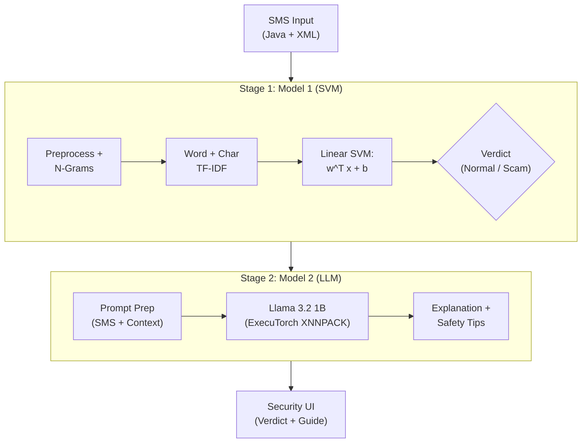

# EdgeShield AI

**Offline Multilingual SMS Scam Detection and AI-Assisted Explanation Using TF-IDF, Linear SVM, Llama 3.2 1B, and ExecuTorch**

[](#)
[](#)
[](#)
[](#)

> **PS3 — Bharat AI Challenge** | SRM Institute of Science & Technology

---

## Overview

**EdgeShield AI** is a privacy-first Android cybersecurity application that detects SMS phishing (*smishing*) across **English, Hindi, and Hinglish** and generates plain-language safety explanations entirely on-device—with zero cloud API calls.

The system uses a **decoupled two-stage Edge AI pipeline**:

1. **Stage 1 — Deterministic Screening (Model 1):** A Word + Character TF-IDF + Linear SVM classifier delivers sub-millisecond threat classification directly inside the Android app (`97.83%` accuracy, `96.98%` scam F1-score across 85,811 messages).

2. **Stage 2 — On-Device AI Explanation (Model 2):** A quantized **Llama 3.2 1B** model (`SpinQuant` + `XNNPACK`) runs locally via **ExecuTorch** to explain suspicious indicators and provide actionable safety guidance.

Even if LLM generation is delayed or unavailable, the deterministic SVM verdict stands independently.

---

## System Architecture



### Component Breakdown

| Component | Training / Preparation | On-Device Execution |
| :--- | :--- | :--- |
| **TF-IDF + Linear SVM** | Python + `scikit-learn` on Windows (PyCharm) | Sparse feature extraction & linear dot product ($w^T x + b$) |
| **Llama 3.2 1B** | Exported/quantized `llama_3_2_1b_xnnpack_spinquant.pte` | ExecuTorch runtime with XNNPACK CPU acceleration |
| **UI & Orchestration** | Java + XML in Android Studio (`MainActivity.java`) | 3-panel Security UI, automatic asset extraction, inference flow |
| **Packaging** | Gradle + Android SDK/NDK (`arm64-v8a`) | Self-contained offline APK (`Version 1.0`, `1.14 GB`) |

---

## Dataset & Preprocessing

To cover modern phishing patterns and multilingual transliterations, two specialized datasets were consolidated with group-aware duplicate handling (80:20 split) to prevent template leakage:

* **ScamShield Dataset:** [`sidzzz07/scamshield-dataset`](https://huggingface.co/datasets/sidzzz07/scamshield-dataset) (Hugging Face)
* **SMS Phishing Dataset:** [`NLM Dataset Catalog 0001449541`](https://datasetcatalog.nlm.nih.gov/dataset?q=0001449541)

| Partition | Record Count | Details |
| :--- | :---: | :--- |
| **Total Cleaned Corpus** | **85,811** | Consolidated & standardized (`0 = Normal/Ham`, `1 = Scam`) |
| **Frozen Training Set** | **68,652** | Split internally into `55,017` train / `13,635` validation for tuning |
| **Frozen Held-Out Test Set** | **17,159** | `10,950` Ham (63.81%) and `6,209` Scam (36.19%) |

---

## Model Performance & Benchmarks

### 1. Held-Out Test Performance (17,159 SMS Messages)

| Metric | Normal SVM (Baseline, $C = 0.1$) | TF-IDF + SVM (Proposed, $C = 3.0$) | Improvement |
| :--- | :---: | :---: | :---: |
| **Overall Accuracy** | 97.22% | **97.83%** | **+0.61 pp** |
| **Scam Precision** | 96.86% | **97.39%** | **+0.53 pp** |
| **Scam Recall** | 95.41% | **96.59%** | **+1.18 pp** |
| **Scam F1-Score** | 96.13% | **96.98%** | **+0.85 pp** |
| **Ham Precision / Recall / F1** | 97.42% / 98.25% / 97.83% | **98.07% / 98.53% / 98.30%** | Higher across all |
| **Total Misclassifications** | 477 (285 FN, 192 FP) | **373 (212 FN, 161 FP)** | **-104 errors (-21.8%)** |
| **Model Size / Batch Latency** | 1.01 MB / 0.0584 ms | **2.54 MB / 0.4479 ms** | Sub-millisecond |

* **Multilingual Evaluation:** Hindi F1-score `~95.61%` | Hinglish F1-score `~95.70%`

### 2. On-Device Verification & Parity

Tested on **POCO F7** (Snapdragon 8s Gen 4, 12 GB RAM, Android ARM64) in full offline / Airplane mode:

* **Python-to-Android SVM Parity:** `120 / 120` exact label matches (max decision-score discrepancy: $3.76 \times 10^{-8}$).
* **Llama 3.2 1B Load Time:** `~2.79 seconds` (recorded development run).
* **Generation Throughput:** `~33.57 - 37.48 tokens/second` via ExecuTorch XNNPACK CPU backend.
* **Self-Contained APK Footprint:** `1.14 GB` APK; automatically extracts the `~1.08 GB` `.pte` model and `~17.2 MB` tokenizer into app-private storage on first launch (`1.10 GB` extracted data).

---

## Repository Structure

```text
EdgeShield-AI---BharatAIChallenge/
├── android/                     # Android Studio project (Java + XML, Gradle, ExecuTorch)
│   ├── app/
│   │   ├── src/                 # MainActivity.java, XML layouts, assets/models/
│   │   ├── build.gradle
│   │   └── proguard-rules.pro
│   ├── build.gradle
│   ├── gradle.properties
│   └── settings.gradle
├── dataset/                     # Dataset documentation and source references
│   ├── readme.md
│   └── sources.txt
├── ml/                          # Python ML training, evaluation & export pipeline
│   ├── clean_datasets.py        # Consolidation, deduplication & group-aware 80:20 split
│   ├── compare_svm_models.py    # Hyperparameter tuning & Baseline vs TF-IDF benchmarking
│   ├── export_svm_android.py    # Export sparse TF-IDF + Linear SVM weights for Android
│   ├── plot_svm_comparision.py  # Generate 4-panel comparative performance charts
│   └── validate_multilingual.py # Hindi & Hinglish slice evaluation
├── .gitignore                   # Excludes >100 MB *.pte models, build/, .venv/, credentials
└── README.md
```

---

## Setup & Build Guide

### Prerequisites

* **Host OS:** Windows 11 (for Python ML & Android Studio) + **WSL2 Ubuntu 24.04** (for ExecuTorch model export/source builds).
* **Tools:** Python 3.11, Android Studio (SDK, NDK r28c / `28.2.13676358`, CMake), Git, Visual Studio 2022 Community (C++ Desktop workload).

### 1. Run the ML Pipeline (Windows PowerShell / PyCharm)

```bash
cd ml
python -m venv .venv
.venv\Scripts\activate
pip install scikit-learn pandas numpy matplotlib
python clean_datasets.py
python compare_svm_models.py
python export_svm_android.py
```

### 2. Model Artifacts (Excluded from Git)

Because `llama_3_2_1b_xnnpack_spinquant.pte` (~1.08 GB) exceeds GitHub's 100 MB file limit, `.pte`, `.bin`, and `.model` files are excluded via `.gitignore`.

To build the self-contained APK locally:

1. Export or download `llama_3_2_1b_xnnpack_spinquant.pte` and its compatible `tokenizer.model` (~17.2 MB) using the official [ExecuTorch Llama Android workflow](https://github.com/pytorch/executorch/tree/main/examples/models/llama).
2. Place both files inside:
   ```text
   android/app/src/main/assets/models/llama/
   ```
3. Open `android/` in **Android Studio**, ensure `abiFilters 'arm64-v8a'` is set, and build/install the APK on an ARM64 Android device.

*(Pre-built APK releases are also available under the **Releases** tab of this repository.)*

---

## Key Engineering Breakthroughs

* **Overcoming Mobile OOM (SpinQuant Quantization):** Full-precision BF16/FP16 Llama 3.2 1B weights (~2.5 GB + KV cache) caused immediate Out-of-Memory crashes on mobile. Switching to the quantized `SpinQuant` XNNPACK export reduced the model to `~1.08 GB`, enabling stable offline loading.
* **Automatic APK Asset-Extraction Pipeline:** ExecuTorch requires standard filesystem paths rather than raw APK asset handles. Bundling the `.pte` model and tokenizer inside `assets/models/llama/` and extracting them into Android app-private internal storage on first launch eliminated hardcoded host paths and created a plug-and-play offline APK.

---

## Security & Responsible-Use Notes

* **Local-Only Privacy:** SMS messages are processed strictly on-device; no text is transmitted to external servers, analytics, or crash-reporting services.
* **No Automated External Actions:** The app never automatically opens URLs, dials numbers, or sends replies.
* **Prompt-Injection Defense:** Untrusted SMS content is strictly delimited so Llama 3.2 1B treats it as data rather than executable instructions.
* **Honest Uncertainty:** The Linear SVM decision margin ($w^T x + b$) is displayed as a raw signed score—not a calibrated probability—and Llama's output is advisory only (no live URL or bank identity verification).

---

## Team & Acknowledgments

* **Team Members:** Jagaputhran S, Keerthivasan Krishnamoorthy, Kartikeya Aripirala
* **Project Guide:** Dr. R Jansi
* **Institution:** SRM Institute of Science & Technology

---

## References

1. [ScamShield Dataset — Hugging Face (`sidzzz07/scamshield-dataset`)](https://huggingface.co/datasets/sidzzz07/scamshield-dataset)
2. [SMS Phishing Dataset — NLM Dataset Catalog (`0001449541`)](https://datasetcatalog.nlm.nih.gov/dataset?q=0001449541)
3. [ExecuTorch Android Integration Documentation](https://docs.pytorch.org/executorch/stable/using-executorch-android.html)
4. [ExecuTorch Llama Model Examples & Android Demo](https://github.com/pytorch/executorch/tree/main/examples/models/llama)
5. [Llama 3.2 1B Instruct Model Card](https://huggingface.co/meta-llama/Llama-3.2-1B-Instruct)
6. [scikit-learn `LinearSVC` & `TfidfVectorizer` Documentation](https://scikit-learn.org/stable/modules/generated/sklearn.svm.LinearSVC.html)
7. [Android NDK & SDK Documentation](https://developer.android.com/ndk)
